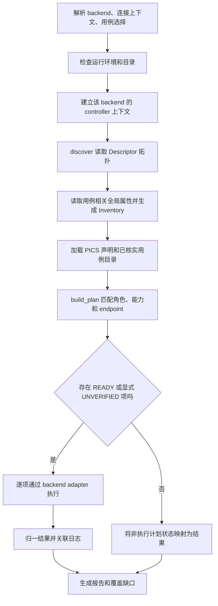
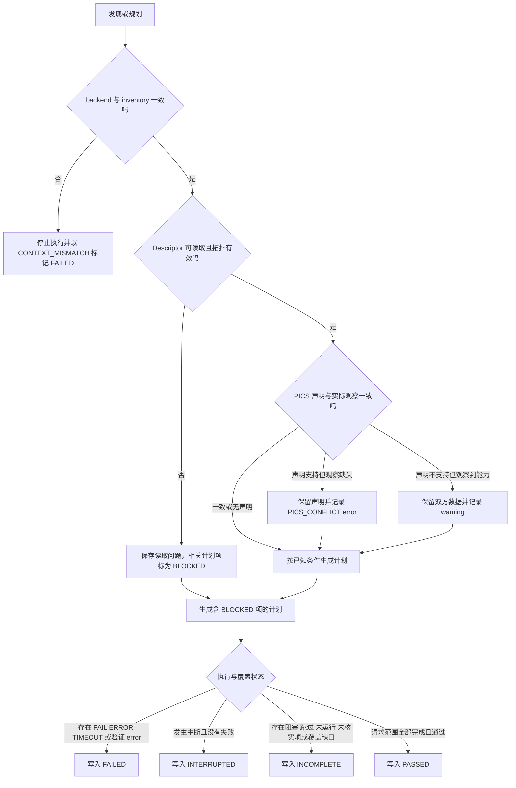

# Matter DUT 通用测试框架设计报告

> 关联设计：[通用测试框架代码计划](../../../bouffalo-test-runner-code-plan.md)

## 1. 目标

### 1.1 核心目标

建立一套依据 Matter DUT 的角色、endpoint 拓扑和可观察能力来选择并运行测试的框架，使任意 example 可经由用例目录接入，不依赖 app 名称、源码目录名或固定 endpoint 编号。

### 1.2 约束与假设

- DUT 角色由运行参数或用例元数据声明，不从 app 名称或 endpoint 推断。server、client、commissioner 和 mixed 场景均可登记；场景依赖未配置时明确阻塞，不把该角色排除在框架之外。
- Python 与 YAML backend 在一次运行中二选一，各自使用自己的 controller 配置和 fabric。框架不迁移密钥、不要求两个 backend 共享 fabric，也不跨 backend 混用发现结果和执行状态。
- 动态 endpoint 由 Descriptor 拓扑发现；endpoint ID 不作为设备功能身份，报告记录 endpoint 与节点上下文。
- 用户提供的 PICS 是测试声明。实际发现结果可触发不一致或阻塞，但不得静默过滤与声明矛盾的测试。
- v1 自动选择只纳入目录中已核实适用条件和执行参数的用例。用户仍可显式运行未登记的 Python/YAML 用例；这种运行不做适用性推断，并在计划和报告中标记 `UNVERIFIED`。
- YAML backend 的 WebSocket adapter 是已有执行路径。用于能力发现的 adapter 调用/命令需要新增或验证，不假定现有 runner 已提供任意属性读取 API。

## 2. 现状分析

### 2.1 已有能力

- Python 测试环境已有 Matter `DeviceController`，可通过 `ReadAttribute` / `Read` 读取节点属性。
- YAML 测试通过 `matter.yamltests.websocket_runner` 与 WebSocket adapter 通信；仓库的 chip-tool adapter 承载命令转发和执行。
- 现有 Bouffalo runner 已能启动测试并收集日志，但选择集合、参数映射和报告逻辑面向既有测试入口，尚无通用能力模型。
- 现有 bridge example 可动态建立 endpoint，因此按 endpoint 1 或 app 名称推断能力不可靠。

### 2.2 缺口分析

- 缺少 backend 无关的 DUT inventory、用例适用条件、执行计划和结构化结果模型，以及 list/check/discover/plan/dry-run 诊断入口。
- 缺少通过 Descriptor 遍历 endpoint、读取 DeviceTypeList/ServerList/ClientList 并建立拓扑关系的通用发现流程。
- Python 与 YAML backend 使用独立 fabric 上下文；目前没有可依赖的跨 backend 共享配对状态。
- YAML backend 的发现读取适配尚待实现或接口核实，不能将 YAML 测试命令适配器等同于已存在的属性读取接口。
- PICS 声明、观察到的能力与用例适用性尚无显式分层，容易把实现缺失误当成不适用。

## 3. 数据模型与接口

### 3.1 数据模型

以下为新增的框架模型，不代表仓库已经存在同名类型。JSON 中使用 snake_case 字段；标记为 `unknown` 的数据不可转换为“不支持”。

| 模型 | 字段 | 约束与用途 |
|---|---|---|
| `BackendContext` | `backend: python\|yaml`, `node_id: uint64`, `dut_role: server\|client\|commissioner\|mixed`, `storage_ref: string`, `fabric_ref: string` | 单次运行上下文；角色由用户/用例声明。存储引用不包含密钥内容，fabric 引用仅标识本 backend 上下文。 |
| `Inventory` | `schema_version: string`, `backend_context: BackendContext`, `captured_at: datetime`, `endpoints: Endpoint[]`, `read_issues: ReadIssue[]` | 每份 inventory 描述一个节点；client DUT 可没有功能 server endpoint。peer 由场景 fixture 提供独立 inventory 引用；不得跨 backend 直接执行。 |
| `Endpoint` | `endpoint_id: uint16`, `device_types: DeviceType[]`, `parts_list: uint16[]\|unknown`, `clusters: ClusterCapability[]` | `DeviceType` 为 `{id:uint32, revision:uint16}`；endpoint ID 仅为当前拓扑地址，关系来自 Descriptor。 |
| `ClusterCapability` | `cluster_id: uint32`, `role: server\|client`, `feature_map: uint32\|unknown`, `attribute_ids: uint32[]\|unknown`, `accepted_command_ids: uint32[]\|unknown`, `generated_command_ids: uint32[]\|unknown`, `revision: uint16\|unknown` | 全局属性读取失败保存 `ReadIssue{endpoint_id:uint16?,cluster_id:uint32?,attribute_id:uint32?,code:string,message:string}`，不推断为不支持。 |
| `PicsDeclaration` | `source: string`, `scope: node\|endpoint`, `values: map<string, bool\|unknown>`, `digest: string` | 用户声明与 inventory 分开保存；scope 明确，未知声明不补默认值。 |
| `Requirement` | `scope: node\|endpoint`, `cluster_id: uint32`, `role: server\|client`, `device_type_ids: uint32[]`, `feature_bits_all: uint32`, `attribute_ids: uint32[]`, `command_ids: uint32[]` | 对应一个或多个能力约束；列表为空表示不约束该维度，bit mask 要求包含所列位。 |
| `CaseDefinition` | `id: string`, `backend: python\|yaml`, `script: string`, `dut_role: server\|client\|commissioner\|mixed`, `scope: node\|endpoint\|scenario`, `requirements: Requirement[]`, `pics_requirements: string[]`, `endpoint_argument: string\|null`, `suite: smoke\|functional\|stateful`, `effects: string[]`, `fixtures: string[]`, `timeout_seconds: uint32` | 用例目录仅登记已核实用例。脚本路径相对仓库测试根目录解析，参数按数组传递。 |
| `CaseInstance` | `case_id: string`, `endpoint_id: uint16\|null`, `arguments: string[]`, `selection: explicit\|automatic` | 单个待执行实例；同用例可因匹配到多个 endpoint 生成多个实例。 |
| `Selection` | `mode: list\|check\|discover\|plan\|dry_run\|run`, `case_ids: string[]`, `suite: string\|null`, `explicit_script: string\|null`, `arguments: string[]` | 显式脚本运行时 `case_ids` 恰含用户给的报告 ID，`explicit_script` 为解析后的脚本路径，参数原样进入 instance；backend 与 DUT role 取自 `BackendContext`。未登记脚本不能进入自动匹配。 |
| `PlanEntry` | `instance: CaseInstance`, `status: READY\|UNVERIFIED\|NOT_APPLICABLE\|BLOCKED`, `reason: string\|null` | 不适用只用于已知条件不匹配；未知条件或缺依赖为阻塞。显式未登记用例为 UNVERIFIED，仍可执行，适用性状态保留在 plan。 |
| `CaseResult` | `instance: CaseInstance`, `status: PASS\|FAIL\|SKIP\|TIMEOUT\|ERROR\|NOT_RUN\|BLOCKED\|NOT_APPLICABLE`, `exit_code: int\|null`, `duration_ms: uint64\|null`, `reason: string\|null`, `log_ref: string\|null` | 每条计划项都对应一个结果；READY/UNVERIFIED 执行后记录实际结果，其余计划状态映射为 BLOCKED/NOT_APPLICABLE。 |
| `ValidationIssue` | `code: string`, `severity: error\|warning`, `message: string`, `case_ids: string[]` | 记录 PICS 与观察冲突及上下文校验；error 影响整体状态，不冒充用例执行结果。 |
| `RunReport` | `schema_version: string`, `backend_context: BackendContext`, `inventory_ref: string\|null`, `pics_ref: string\|null`, `plan: PlanEntry[]`, `results: CaseResult[]`, `validation_issues: ValidationIssue[]`, `coverage_gaps: string[]`, `overall: PASSED\|FAILED\|INCOMPLETE\|INTERRUPTED` | 报告区分执行、验证和覆盖；整体归并规则在 §4.2 定义。 |

### 3.2 接口定义

下列为建议新增的 Python 模块接口。具体 backend 调用细节封装在 adapter 中，不能让 catalog 依赖 Python Matter SDK 或 chip-tool 内部实现。

| 接口 | 调用方 → 被调用方 | 输入与输出 | 主要错误 |
|---|---|---|---|
| `discover(context) -> Inventory` | CLI → backend adapter | 当前 backend 配对上下文；读取可观察节点的 Descriptor 拓扑和选例所需全局属性，返回带未知值及读取问题的 inventory。 | `CONNECTION_FAILED`, `READ_FAILED`, `INVALID_TOPOLOGY`, `BACKEND_UNAVAILABLE` |
| `load_catalog(path) -> CaseDefinition[]` | CLI → catalog | 用例目录路径；校验 schema、backend 标识、路径和必要字段。 | `CATALOG_INVALID` |
| `build_plan(inventory?, pics?, cases, selection) -> PlanningResult` | CLI → planner | 返回 `{entries: PlanEntry[], validation_issues: ValidationIssue[]}`；可提供 inventory 或在线 discover；按 role、cluster role、device type、FeatureMap/属性/命令要求及 PICS 作用域匹配。角色相同为兼容，实际角色 `mixed` 可匹配任一专用角色；其余角色不匹配则列为 `NOT_APPLICABLE`。未知 case ID 报 `CASE_UNKNOWN`；未登记脚本由 `selection.explicit_script` 与唯一 case ID 合成临时定义，标记 `UNVERIFIED`，不应用能力规则筛掉；PICS 冲突写入验证项且关联受影响计划，不丢弃候选。空计划正常返回。 | `CONTEXT_MISMATCH`, `CASE_UNKNOWN`, `PICS_INVALID` |
| `execute(context, entry) -> CaseResult` | CLI → backend adapter | 接受 `READY` 或用户显式指定的 `UNVERIFIED` 项；按目录元数据或显式脚本参数执行单个用例。 | `START_FAILED`, `TIMEOUT`, `EXECUTION_ERROR` |
| `write_report(report, output_dir) -> paths` | CLI → reporter | 写入版本化 inventory、plan、summary 和原始日志引用；输出文件路径。 | `REPORT_WRITE_FAILED` |

Backend 映射：Python `discover` 使用当前 `DeviceController` 的 `ReadAttribute` / `Read` 路径；YAML `execute` 沿用当前 WebSocket runner/chip-tool adapter。YAML `discover` 通过该 adapter 在同一 `interactive server --storage-directory` 上下文读取 Descriptor 与全局属性，并将 Matter Read response 转换为结构化值、path 和 status；不把终端文本日志当作数据源。当前 `send_raw_command` 只返回布尔状态并打印日志，不足以满足此契约，因此需扩展 adapter 响应类型。若 chip-tool 不能在所选交互会话提供结构化响应，则该 backend 的 `--discover/--plan` 返回 `BACKEND_UNAVAILABLE`，不另开 fabric 偷读能力。此处不规定未经验证的命令/API 名称。

CLI 至少提供以下工作流：

| 参数/操作 | 行为 |
|---|---|
| `--backend python\|yaml` | 显式选 backend；执行时只使用该 backend 的存储和 fabric。 |
| `--check` / `--list` | 分别检查静态运行环境、离线列出已登记用例；不访问 DUT。 |
| `--discover` | 在线读取并保存 inventory 后退出。 |
| `--plan` | 使用在线发现或 `--inventory <file>` 生成并保存计划，不执行。 |
| `--dry-run` | 展示同一计划与参数，不启动用例；自动规划可用离线 inventory。 |
| `--case <id>` / `--suite <name>` | 选择登记用例；未登记脚本只能经 `--case <id> --script <path>` 显式运行并传 `--case-arg`，生成 `UNVERIFIED` 计划项。 |
| `--commission` | 沿用被选 backend 已有的 BLE Wi-Fi、BLE Thread 或 on-network 配网能力；不提供烧录、复位或 fabric 迁移。未传时使用该 backend 已有存储。 |
| `--pics <file>`、`--node-id <id>`、`--dut-role server\|client\|commissioner\|mixed`、`--suite smoke\|functional\|stateful`、`--storage-path` / `--storage-directory` | 显式给出测试声明、DUT node ID/角色、用例集合与对应 backend 存储；未指定角色时为 `server` 以兼容现有 runner，未指定 suite 时默认 `smoke`。 |

模式互斥：`--check`、`--list`、`--discover`、`--plan`、`--dry-run` 和默认运行每次只选择一个；`--inventory` 仅用于离线计划/预览，不可与在线 `--discover` 混用。

## 4. 核心流程

### 4.1 正常流程

### 4.2 异常路径与声明校验

PICS 冲突本身是可见的验证结果，不能靠从候选集剔除测试来消除。声明支持但设备未观察到能力时，在 `validation_issues` 中生成 error 并影响总状态为 `FAILED`；受影响用例保留在计划中并标为 `BLOCKED`。因发现不完整无法判定的项也报告 `BLOCKED`。声明不支持但观察到能力时保留 warning，不自动覆盖用户输入。每个 `PlanEntry` 均对应一个 `CaseResult`：`READY`/`UNVERIFIED` 经执行后记录真实结果；`BLOCKED`、`NOT_APPLICABLE` 映射为同名结果；中断导致未启动的 `READY` 或 `UNVERIFIED` 项记为 `NOT_RUN`。总状态归并顺序：任何验证 error 或 `FAIL`/`ERROR`/`TIMEOUT` 为 `FAILED`；否则发生中断为 `INTERRUPTED`；否则有 `BLOCKED`/`SKIP`/`NOT_RUN`、UNVERIFIED 计划项、coverage gap 或零个可执行项为 `INCOMPLETE`；其余为 `PASSED`。

## 5. 项目结构与技术决策

### 5.1 文件变更清单

| 文件路径 | 变更类型 | 职责 |
|---|---|---|
| `tools/matter_dut/matter_dut_tests.py` | 新建 | 通用 CLI、运行编排、退出状态。 |
| `tools/matter_dut/matter_dut/backends.py` | 新建 | Python/YAML backend adapter；隔离连接、发现及用例执行。 |
| `tools/matter_dut/matter_dut/inventory.py` | 新建 | Inventory 数据模型、Descriptor 拓扑处理与序列化。 |
| `tools/matter_dut/matter_dut/catalog.py` | 新建 | 用例目录加载、元数据校验和能力匹配规划。 |
| `tools/matter_dut/matter_dut/catalog.json` | 新建 | v1 已核实可自动规划的用例元数据。 |
| `tools/matter_dut/matter_dut/report.py` | 新建 | 结果归一、覆盖缺口和 JSON/TXT 报告。 |
| `tools/matter_dut/bouffalo_sanity_tests.sh` | 修改 | 保留原快捷用例和任意脚本运行方式；增加列表查询及 Python 环境覆盖。 |
| `tools/matter_dut/bouffalo_yaml_tests.sh` | 修改 | 保留原快捷用例和任意 YAML 运行方式；增加列表查询及 Python 环境覆盖。 |
| `tools/matter_dut/bouffalo_test_common.sh` | 修改 | 保留原共享参数解析，并为旧入口增加列表选项。 |
| `tools/matter_dut/README.matter-dut.md` | 新建 | 通用入口、backend 上下文、目录格式和结果说明。 |
| `tools/matter_dut/README.bouffalo.md` | 修改 | 说明旧入口的快捷列表和兼容用法。 |

依赖方向：CLI 依赖 catalog、backend、report；catalog 只依赖 inventory 的公共数据模型和用例元数据；backend 负责将 Matter stack 读写能力映射为公共模型；report 只消费公共模型。公共规划代码仅依赖 Python 标准库；Matter SDK 依赖留在指定 Python 测试环境，YAML 继续依赖仓库现有 chip-tool/WebSocket 运行环境。v1 不新增第三方依赖。

### 5.2 技术决策

| 决策 | 选择 | 理由 | 替代方案 |
|---|---|---|---|
| 用例自动适用性 | 根据显式 DUT 角色、Descriptor 拓扑、endpoint cluster 能力与用例元数据规划；场景依赖缺失则 BLOCKED | 对应 Matter 能力和场景依赖，适用于不同 example，能支持动态 endpoint。 | 按 app 名称或脚本名匹配会将框架与具体 example 绑定。 |
| Backend 上下文 | 每次运行仅选 Python 或 YAML，fabric 与 storage 保持独立 | 两个 runner/controller 生命周期和配对存储各自管理，避免密钥迁移及跨 fabric 误读。 | 强制共用 fabric 会增加隐式状态转换和安全风险。 |
| 能力读取 | 先遍历 Descriptor，再仅读取目录匹配所需的全局属性；失败显式记为 unknown/issue | 控制读取范围，并区分“不支持”与“不可观察”。 | 扫描所有业务属性耗时且可能改变状态；失败即判不支持会误筛测试。 |
| 用例目录 | 结构化静态目录，要求声明角色、适用条件、endpoint 参数及影响 | 让自动执行集合可审查，可解释每个筛选结果。 | 从脚本名或日志猜测条件无法可靠推导语义。 |
| PICS 处理 | 声明和发现分开存储、逐项比对、冲突可见 | PICS 表达测试预期，inventory 表达当前观察，两者不可互相覆盖。 | 用发现结果过滤 PICS 会隐藏 DUT 不符合声明的缺陷。 |
| 报告 | 版本化 JSON 为事实来源，TXT 为便于阅读的投影 | 支持审计、统计覆盖和后续重跑。 | 仅解析终端摘要会丢失上下文和每 endpoint 结果。 |

## 6. 验收标准

- [ ] 同一框架入口通过 backend 参数分别运行 Python 和 YAML；报告记录各自的 Node ID、存储引用和 fabric 上下文，二者没有共享/迁移要求。
- [ ] 对包含多个 Descriptor endpoint 的 DUT，inventory 记录各 endpoint 的 DeviceTypeList、PartsList 和 server/client cluster；规划结果不假定 endpoint 1 是功能 endpoint。
- [ ] 对属性读取失败的 cluster，inventory 保存读取问题并将依赖该未知能力的用例标为 `BLOCKED`，不将其标为不支持或 `NOT_APPLICABLE`。
- [ ] 用户 PICS 声明支持但 inventory 未观察到对应能力时，报告声明冲突；对应测试不能从计划中静默消失。
- [ ] 用例目录针对不同能力快照生成不同 endpoint 级 CaseInstance；每条 READY 实例仅由所选 backend 执行。
- [ ] 已登记的 server、client、commissioner、mixed 用例均可表达 DUT 角色；未配置的场景依赖显示为 `BLOCKED`，不能被误报为 `NOT_APPLICABLE`。
- [ ] 未登记用例不会被自动加入计划；显式指定未登记脚本时可由指定 backend 执行，计划标记 `UNVERIFIED`；显式用例 ID 不存在时返回可区分的目录错误。
- [ ] `--list`、`--check` 不访问 DUT；`--discover` 保存 inventory；`--plan` 与 `--dry-run` 不执行用例；`--inventory` 支持离线规划。
- [ ] `--commission` 复用所选 backend 的配网和存储，不要求 Python 与 YAML 共享 fabric。
- [ ] 计划项、执行项和报告项可通过 `case_id` 与 endpoint 关联；计划中 BLOCKED、未运行、跳过和覆盖缺口不会被汇总成通过。
- [ ] 运行过程中断、backend 启动失败、用例超时或报告写入错误均留下可识别状态或错误码。
- [ ] 使用代表灯、bridge、传感器等不同能力拓扑的离线 inventory fixture 验证通用规划，不依赖 app 名称分支。

## 7. 暂不实现

| 功能 | 原因 | 备注 |
|---|---|---|
| 所有 Matter cluster 的完整用例覆盖 | 通用框架接入不等于用例覆盖；每个用例仍需验证前置条件和副作用。 | 目录可持续扩充；未覆盖能力报告为 coverage gap。 |
| 自动构建、烧录、复位和固件身份验证 | 各 example 的硬件流程不统一，当前目标是通用 DUT 测试入口。 | 后续以显式场景依赖接入，不按 app 名称分支。 |
| 超出所选 backend 既有能力的配网方式 | 各网络流程需独立验收。 | v1 复用现有 BLE Wi-Fi、BLE Thread、on-network 配网路径。 |
| 自动提供 client/commissioner 的参考设备、触发器及多设备恢复编排 | 不同 example 的启动和触发方式无法通用推断。 | 用例可登记这些角色和依赖；未配置依赖时 BLOCKED，不按 app 名称增加特例。 |
| bridge 子设备、OTA、故障注入和状态恢复专用 fixture | 这些场景有外部依赖和持久状态影响。 | 后续按实际用例定义依赖接口。 |
| 多 fabric 互通、跨 backend 配对状态复用 | Python 与 YAML controller 状态独立，自动迁移会扩大密钥管理范围。 | 本设计不提供共享 fabric 功能。 |
| 未登记脚本的自动推断、筛选和失败重跑 | 脚本语义、endpoint 参数、副作用和重试安全性不能可靠猜测。 | 用户显式指定脚本仍可运行，但适用性保持 UNVERIFIED。 |
| 将 inventory 自动转换成认证用 PICS | 观察到的属性不能表达所有 PIXIT、人工声明和认证语义。 | inventory 派生数据仅用于运行规划，不替代认证资料。 |
